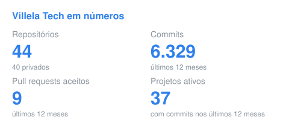
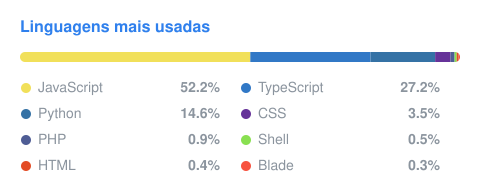

 

### 🏢 Quem somos
- 💼 Somos a área de tecnologia do **Grupo Villela**, em Porto Alegre (RS).
- 👥 Um time de **32 pessoas** em desenvolvimento, infraestrutura, segurança da informação e helpdesk interno.
- 🧑‍💻 Construímos os sistemas que o grupo usa no dia a dia: atendimento, cobrança, análise de crédito, estoque e gestão de projetos.
- 🤖 Aplicamos IA nos processos: assistentes com LLM, busca semântica e integrações que deixam agentes de IA operarem nossos sistemas.
- 🛡️ Segurança é requisito, não etapa final: seguimos um padrão interno de arquitetura e revisão de código alinhado à **ISO/IEC 27001** e à **LGPD**.

---

## 🧩 O que construímos

| Área | Exemplos |
|---|---|
| **Atendimento** | Central multicanal com WhatsApp, e-mail e chat |
| **Cobrança e crédito** | Portal de cobrança, cálculo de capacidade de pagamento e emissão de laudos |
| **Integrações** | CRMs, ERPs, meios de pagamento e bancos conectados por API e webhooks |
| **Operação interna** | Estoque e inventário, controle de ponto, painéis de monitoramento |
| **Plataforma de desenvolvimento** | Desenvolvimento assistido por IA, com validação e aprovação antes da produção |

---

## ⚙️ Backend

---

## 🎨 Frontend

---

## 🔗 Integrações

---

## ☁️ Infraestrutura e dados

---

## 📊 Em números

  
  

Inclui os repositórios privados; só os totais são exibidos. Atualizado todo dia.

---

## 👥 Time no GitHub

---

### 🤝 Contato

  
  <!-- Preencha e descomente:
  
  -->

 

